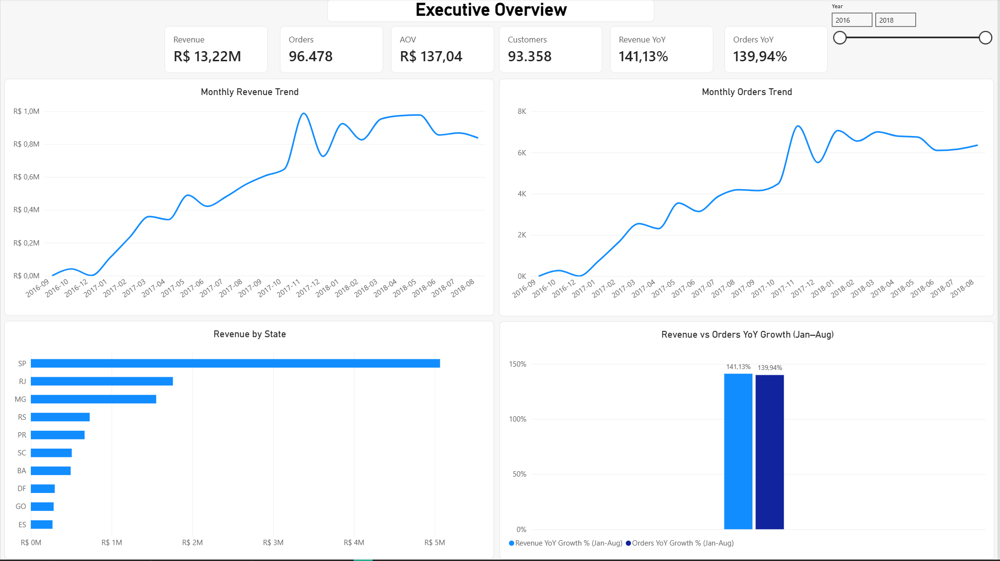
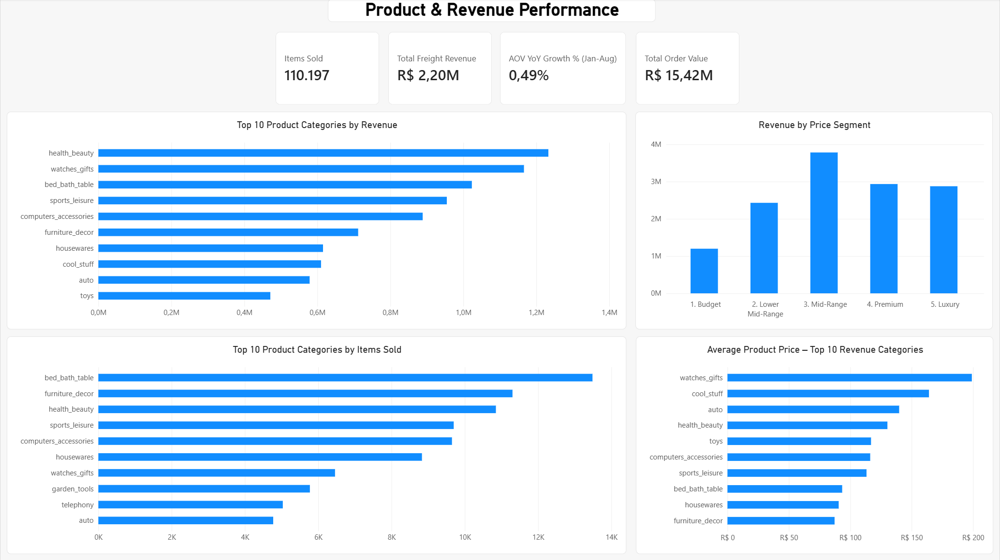
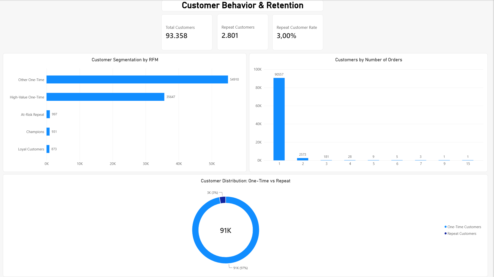
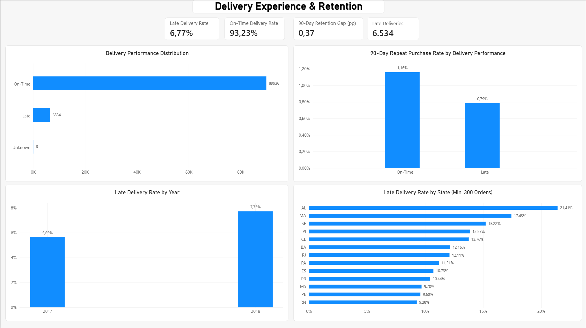

# E-Commerce Customer & Revenue Analytics

End-to-end analysis of Brazilian e-commerce transactions using MySQL and Power BI, covering revenue performance, product trends, customer purchasing behavior, and delivery reliability.

The project uses the public Olist Brazilian E-Commerce dataset. SQL is used to inspect, validate, and transform the source tables, while Power BI provides a four-page report for exploring business performance and customer retention.

## Project Objectives

- Track revenue, order volume, and average order value over time.
- Identify the product categories, price segments, and regions contributing to sales.
- Measure customer repeat purchasing and develop behavioral segments.
- Evaluate delivery performance across years and states.
- Compare 90-day repeat purchase rates between customers whose first delivered order arrived on time and those whose order arrived late.

## Tools and Technologies

- **MySQL 8:** Relational data preparation, validation, and analytical transformations.
- **SQL:** Data quality checks, aggregation, customer-level metrics, and reporting datasets.
- **Power BI:** Data modeling, DAX measures, interactive visuals, and dashboard development.
- **Power Query:** Data loading and preparation for reporting.

## Dataset

**Source:** [Brazilian E-Commerce Public Dataset by Olist (Kaggle)](https://www.kaggle.com/datasets/olistbr/brazilian-ecommerce)

The source contains related tables for orders, customers, order items, payments, products, sellers, reviews, and geographic information, plus a product category translation table.

The analysis focuses on delivered orders when calculating completed sales and delivery outcomes.

Raw CSV files are not included in this repository. Download the source dataset from Kaggle to reproduce the database setup and import process.

## Data Preparation and Quality Checks

The SQL workflow covers table creation, data import, source validation, and transformation into analysis-ready datasets.

Checks include missing values, record consistency, referential integrity, financial anomalies, and reconciliation between recorded payments and calculated order values.

One reconciliation check identified **303 mismatched orders among 98,665 orders with both item and payment records** (approximately **0.31%**).

Rather than overwriting source values to force a match, the analysis keeps product value, freight, and recorded payment amounts as separate financial measures.

Additional validation findings and handling decisions are documented in [`02_SQL/04_data_quality_summary.md`](02_SQL/04_data_quality_summary.md).

## Key Performance Indicators

The main report uses delivered orders as the basis for completed-order performance.

| Metric | Result |
| --- | ---: |
| Delivered orders | 96,478 |
| Unique customers | 93,358 |
| Items sold | 110,197 |
| Product revenue | R$13,221,498.11 |
| Freight revenue | R$2,198,275.64 |
| Total order value (products + freight) | R$15,419,773.75 |
| Average order value | R$137.04 |
| Repeat customers | 2,801 |
| Repeat customer rate | 3.00% |
| Late delivery rate | 6.77% |

Product revenue excludes freight. Total order value includes freight.

Average order value is calculated as product revenue divided by delivered orders.

Keeping these definitions separate avoids comparing financial metrics with different components.

## Power BI Dashboard

The report contains four pages covering business performance, customer behavior, and delivery outcomes.

The Power BI report file is stored in `04_PowerBI/`.

### 1. Executive Overview

The Executive Overview provides a high-level view of business performance through revenue, order volume, average order value, and customer metrics.

It includes:

- Monthly revenue and order trends.
- Revenue distribution across Brazilian states.
- Year-over-year revenue and order growth.
- Interactive year filtering.



### 2. Product & Revenue Performance

This page examines how product categories and pricing segments contribute to overall revenue.

It includes:

- Top product categories by revenue.
- Revenue distribution by price segment.
- Best-selling categories by item volume.
- Average product prices across leading categories.
- Freight revenue and total order value.



### 3. Customer Behavior & Retention

This page focuses on customer purchasing patterns and the distribution of one-time and repeat buyers.

It includes:

- Customer segmentation based on purchasing behavior and value.
- Customer distribution by number of orders.
- One-time versus repeat customer comparison.
- Repeat customer rate.



### 4. Delivery Experience & Retention

This page evaluates delivery reliability and explores its relationship with subsequent customer purchases.

It includes:

- On-time and late delivery rates.
- Delivery performance distribution.
- Late delivery trends by year.
- State-level late delivery comparisons.
- 90-day repeat purchase rates by first-order delivery outcome.



## Key Findings

### Revenue Growth Was Driven Primarily by Order Volume

For a like-for-like comparison of **January–August 2018 versus January–August 2017**:

| Metric | Year-over-year change |
| --- | ---: |
| Product revenue | +141.13% |
| Delivered orders | +139.94% |
| Average order value | +0.49% |

Revenue and order growth moved closely together, while average order value changed very little.

This indicates that increased transaction volume, rather than larger average baskets, accounted for most of the observed revenue growth.

### Repeat Purchasing Was Limited

Of **93,358 customers**, only **2,801** placed more than one order, producing a **3.00% repeat customer rate** in the analyzed data.

Most customers appeared only once, making repeat purchasing an important area for further investigation.

Customer segmentation distinguishes high-value one-time customers from repeat customer groups, helping identify potential retention and reactivation opportunities.

### Late Deliveries Affected a Minority of Completed Orders

Of the **96,478 delivered orders**:

| Delivery status | Orders |
| --- | ---: |
| On time | 89,936 |
| Late | 6,534 |
| Unknown | 8 |

Delivery lateness is defined using the **calendar date** of actual delivery compared with the estimated delivery date, rather than comparing exact timestamps.

This definition is applied consistently throughout the report.

The late delivery rate increased from **5.65% in 2017** to **7.73% in 2018** within the observed data.

State-level comparisons use a minimum order threshold to reduce the influence of very small samples.

### On-Time First Deliveries Were Associated with Higher 90-Day Repeat Purchasing

The retention analysis focuses on customers with at least 90 days of observable follow-up after their first delivered order.

| First-order delivery outcome | Eligible customers | Repeat purchasers within 90 days | Repeat purchase rate |
| --- | ---: | ---: | ---: |
| On time | 67,826 | 787 | 1.16% |
| Late | 5,217 | 41 | 0.79% |

The observed difference was approximately **0.37 percentage points** in favor of on-time deliveries.

An additional stratified analysis, controlling for first purchase year and first-order value quintile, produced the following results:

| Statistical measure | Result |
| --- | ---: |
| Mantel–Haenszel odds ratio | 1.47 |
| 95% confidence interval | 1.07–2.02 |
| Cochran–Mantel–Haenszel p-value | 0.0156 |

The results suggest an association between first-order delivery performance and subsequent purchasing behavior.

However, this is an observational analysis and does not establish that delayed deliveries directly cause lower customer retention.

Other customer, product, and operational factors may influence both delivery outcomes and future purchases.

## Analytical Definitions and Limitations

### Metric Definitions

- **Revenue:** Sum of product item prices for delivered orders, excluding freight.
- **Average order value:** Product revenue divided by the number of delivered orders.
- **Repeat customer:** A customer with more than one order in the analyzed customer history.
- **Late delivery:** Actual delivery calendar date later than the estimated delivery calendar date.
- **90-day repeat purchase:** A subsequent order within 90 days after the first delivered order, measured only for customers with a complete 90-day observation window.
- **Year-over-year growth:** January–August 2018 compared with January–August 2017 to align reporting periods.

### Limitations

- The dataset is historical and does not represent current market conditions.
- Customer activity outside the available dataset cannot be observed.
- Retention findings are observational and should not be interpreted as causal effects.
- Delivery performance may be influenced by geographic, logistical, and product-related factors not fully captured in the analysis.
- Financial metrics are calculated using explicitly defined components to avoid mixing product revenue, freight, and recorded payments.

## Business Recommendations

### 1. Investigate Repeat Purchasing Opportunities

The low repeat customer rate suggests an opportunity to examine customer retention more closely.

High-value one-time customers could be prioritized for targeted post-purchase engagement, with results measured through repeat purchase behavior.

### 2. Prioritize Delivery Reliability

Delivery performance varies across years and geographic regions.

States with elevated late delivery rates should be investigated while accounting for order volume and operational differences.

Improving delivery reliability may contribute to a better customer experience, although its impact on repeat purchasing requires further validation.

### 3. Monitor the Quality of Revenue Growth

Revenue growth should be evaluated alongside order volume and average order value.

This helps distinguish growth driven by additional transactions from growth driven by larger purchases.

### 4. Validate Retention Initiatives Experimentally

Controlled experiments can help evaluate whether delivery improvements or customer engagement programs lead to measurable changes in repeat purchasing.

Relevant measures include repeat purchase rate, customer value, delivery performance, and operational costs.

## Repository Structure

```text
E-Commerce-Customer-Revenue-Analytics/
├── 02_SQL/
│   ├── 01_create_tables.sql
│   ├── 02_import_data.sql
│   ├── 03_data_quality_checks.sql
│   ├── 04_data_quality_summary.md
│   └── 05_data_transformation.sql
├── 04_PowerBI/
│   └── Ecommerce_Customer_Revenue_Analytics.pbix
├── 05_Screenshots/
│   ├── 01_executive_overview.png
│   ├── 02_product_revenue_performance.png
│   ├── 03_customer_behavior_retention.png
│   └── 04_delivery_experience_retention.png
└── README.md
```

The structure above lists the core files intended for publication.

Local working folders and raw source datasets are not required in the published repository.

## Reproducing the Analysis

1. Download the Olist dataset from the Kaggle link provided above.
2. Create the MySQL tables using `02_SQL/01_create_tables.sql`.
3. Update the local CSV import paths as needed and execute `02_SQL/02_import_data.sql`.
4. Run `02_SQL/03_data_quality_checks.sql` and review the documented findings.
5. Execute `02_SQL/05_data_transformation.sql` to prepare the analytical datasets.
6. Open the Power BI report in `04_PowerBI/` and configure the data source connection for the local environment if required.

## Author

**Dimitris Votsis**

GitHub: [dvotsis-data](https://github.com/dvotsis-data)
